# RLReplay

[](https://github.com/yu830/rlreplay/actions/workflows/ci.yml)

A debugging and regression-testing tool for LLM training.

Capture a computation, check its declared contract, replay a failure, and export
a regression test.

Apache-2.0

[Goal](GOAL.md) · [Documentation](docs/index.md) · [Quick start](docs/quickstart.md) ·
[Compatibility](docs/compatibility.md) · [中文上手](docs/zh/quickstart.md)

## Goal

Provide a practical tool engineers can use to diagnose LLM training computations
and verify fixes. Detect silent violations of declared training
contracts, diagnose them through independent validation and linked evidence,
replay failing computations under explicit reproducibility conditions, and turn
verified defects into automated regression tests.

The project grows through additional algorithm contracts, framework adapters and
qualified deployment scenarios. The long-term objectives and extension criteria
are maintained in [GOAL.md](GOAL.md).

## Current scope

The current implementation checks outcome-GRPO group identity, masks, rewards and
advantages in pinned verl and TRL configurations. Core uses the Python standard
library, with an optional safetensors codec for numeric storage. Supported
versions, modes and numerical assumptions are listed in
[Compatibility](docs/compatibility.md).

| Framework | Capture and check | Semantic replay | Native replay | Native regression export |
|---|---|---|---|---|
| verl | Qualified CPU driver boundary | Available | Qualified driver | Available |
| TRL | Qualified single-process CPU Trainer hooks | Available | [Frozen-provider CPU method](docs/trl-native-replay.md) | Available for the explicit native bundle |

## Command-line tool

Download the wheel from the [0.1.0 GitHub Release](https://github.com/yu830/rlreplay/releases/tag/v0.1.0)
and install it with Python 3.11 or later:

```bash
python -m pip install ./rlreplay-0.1.0-py3-none-any.whl
```

After installation, run `rlreplay --help`. The same commands are available through
`python -m rlreplay`. From a source checkout, use `uv run --locked rlreplay --help`.
The JSON workflow below needs no training framework or model download.

## Try the JSON workflow

From a source checkout, with Python 3.11 or later and uv installed, run the
synthetic healthy/faulty example. It uses CPU arithmetic and local JSON files.

```bash
uv sync --locked
uv run --locked python examples/frozen_contract.py ./demo-output
```

The example prints the generated capsule paths and the expected results.

```text
healthy → PASS
faulty  → SUSPECTED_MISMATCH
```

For commands that discover the generated paths automatically, use one of the
following shell-specific workflows. Each creates a fresh directory for its run.

<details>
<summary>Windows PowerShell</summary>

```powershell
uv sync --locked
$demo = Join-Path ([IO.Path]::GetTempPath()) ("rlreplay-demo-" + [guid]::NewGuid())
uv run --locked python examples/frozen_contract.py $demo
$healthyCapsule = (Get-ChildItem -LiteralPath (Join-Path $demo 'healthy') -Filter '*.json').FullName
$faultyCapsule = (Get-ChildItem -LiteralPath (Join-Path $demo 'faulty') -Filter '*.json').FullName
uv run --locked python -m rlreplay inspect $healthyCapsule
uv run --locked python -m rlreplay check $healthyCapsule
uv run --locked python -m rlreplay check $faultyCapsule
uv run --locked python -m rlreplay replay $faultyCapsule
uv run --locked python -m rlreplay diff $healthyCapsule $faultyCapsule
```

</details>

<details>
<summary>Linux / WSL bash</summary>

```bash
uv sync --locked
demo_dir=$(mktemp -d)
uv run --locked python examples/frozen_contract.py "$demo_dir"
healthy_capsule=$(find "$demo_dir/healthy" -name '*.json' -type f)
faulty_capsule=$(find "$demo_dir/faulty" -name '*.json' -type f)
uv run --locked python -m rlreplay inspect "$healthy_capsule"
uv run --locked python -m rlreplay check "$healthy_capsule"
uv run --locked python -m rlreplay check "$faulty_capsule"
uv run --locked python -m rlreplay replay "$faulty_capsule"
uv run --locked python -m rlreplay diff "$healthy_capsule" "$faulty_capsule"
```

</details>

The healthy check exits 0. The faulty check and semantic replay exit 2, and diff
exits 0 after reporting the changed sample. Semantic replay recomputes the
independent reference and checks the captured observations against it.

| Exit code | Meaning |
|---|---|
| 0 | PASS, or a completed inspect/diff/export operation |
| 1 | CONTRACT_VIOLATION |
| 2 | SUSPECTED_MISMATCH |
| 3 | INCONCLUSIVE |
| 4 | Input, source or environment error |

## Architecture

The capture path freezes owned observations before queue publication. An isolated
worker encodes and publishes capsules, and can run the Oracle when enabled.
Offline checks and replay read the same versioned evidence.

<picture>
  <source media="(prefers-color-scheme: dark)" srcset="docs/assets/overview-dark.svg">
  
</picture>

[Detailed architecture](docs/architecture.md) · [Full-size overview](docs/assets/overview.svg) · [Diagram source](docs/assets/overview.mmd)

`Evidence`, `Profile` and `Finding` carry the framework-independent contract.
Adapters map the framework's actual configuration and observations into it.
Independent oracles qualify the result, while native runners bind replay to the
recorded implementation and runtime. Producer-supplied identity and source
records remain part of the trust boundary.


## Capture a training computation

Choose a qualified version and configuration from the compatibility matrix.
Install RLReplay in the corresponding training environment.

- **verl** uses `VerlObserver.around()` at the driver advantage boundary. Supply
  producer membership and the declared profile, and preserve sample IDs through
  framework reordering.
- **TRL** uses `GRPOCaptureMixin` before the qualified `GRPOTrainer` in the class
  MRO. Supply opaque dataset group IDs, a Recorder and a run ID. The mixin reads
  actual settings and wraps the native reward and advantage hooks.

Close the caller-owned Recorder and inspect completion, drop and error receipts.
`check=True` enables worker-side Oracle summaries. `COMPLETE` reports capsule
publication, while the check result is recorded separately.

[Integration examples](docs/adapters.md) · [Runtime budgets and data handling](docs/production.md)

## Native replay and regression

For a real verl driver capsule, run the following in a compatible training
environment where RLReplay and the recorded framework dependencies are installed.
Replace the input path with that captured capsule.

```bash
python -m rlreplay replay /path/to/verl-capsule.json --runner verl
python -m rlreplay export-test /path/to/verl-capsule.json ./new-regression
python -m pytest ./new-regression/test_replay.py
```

Native replay checks the recorded source/runtime fingerprints. Candidate-fix
verification can explicitly use `--allow-revision-change`. Generated tests opt
into candidate verification and should be reviewed before execution. A known
fault remains failing until the installed candidate satisfies the declared
contract. Standard TRL additionally supports explicit
[frozen-provider native replay and regression export](docs/trl-native-replay.md).
Its separate bundle records text and token IDs and uses a caller-supplied Trainer.

## Validation and examples

The initial public snapshot recorded a 91-item test suite across four
Python/platform environments and a fixed set of healthy, faulty, uncertain and
damaged-input cases. Published validation records identify their source versions,
denominators and execution conditions. Framework-native case studies record the
original failure and candidate-fix behavior.

[Validation](docs/validation.md) · [Failure case](docs/case-studies/verl-normalization.md) ·
[Benchmark methodology](benchmarks/README.md)

## Development

```bash
uv sync --locked --dev --extra binary
uv run --locked --extra binary pytest
uv run --locked --extra binary ruff check .
uv run --locked --extra binary ruff format --check .
```

The binary extra enables the optional-codec tests. New adapters and contracts
should include supported configurations, independent expectations, negative
controls and a reproducible framework entry-point check.

[Contributing](CONTRIBUTING.md) · [Security reporting](SECURITY.md)

## License

Apache-2.0. See [LICENSE](LICENSE).
