# Architecture

RLReplay separates framework observations from the evidence and mathematical
contract used to check them. Adapters run at a declared training boundary. The
capture runtime freezes owned values, and an isolated worker encodes and publishes
a versioned capsule. The same capsule can be inspected and checked offline.

<picture>
  <source media="(prefers-color-scheme: dark)" srcset="assets/architecture-dark.svg">
  
</picture>

[Full-size diagram](assets/architecture.svg) · [Mermaid source](assets/architecture.mmd)

The diagram describes the default numeric capture path. Explicit
[TRL native replay](trl-native-replay.md) uses a separate bounded bundle and a
caller-owned real Trainer with frozen generation/reward providers.

## Responsibilities

| Component | Responsibility | Source |
|---|---|---|
| Adapter | Bind actual configuration, stable identities and numeric observations to the declared profile | [`adapters/`](../src/rlreplay/adapters/) |
| Core model | Represent `Evidence`, `Profile`, `Sample` and qualified `Finding` results | [`core.py`](../src/rlreplay/core.py) |
| Recorder | Reserve capacity, freeze owned values, report receipts and release owned resources | [`capture.py`](../src/rlreplay/capture.py) |
| Artifact format | Bound payloads, validate schema/content, publish JSON or optional numeric capsules | [`artifacts.py`](../src/rlreplay/artifacts.py) |
| Correctness oracle | Evaluate structural contracts and independent numerical expectations | [`contracts/grpo.py`](../src/rlreplay/contracts/grpo.py) |
| Replay | Recompute a semantic reference or invoke a qualified native implementation | [`replay.py`](../src/rlreplay/replay.py) |
| TRL method replay | Freeze explicit provider inputs, check source/configuration, execute the full native method and export a candidate regression | [`trl_replay.py`](../src/rlreplay/trl_replay.py) |
| Telemetry | Convert caller-owned statistics to fixed numeric counters and gauges | [`telemetry.py`](../src/rlreplay/telemetry.py) |

## Capture and failure handling

Admission happens before payload conversion. The Recorder freezes supported
primitive values so later mutations in training cannot change the queued
observation. The worker validates and encodes that snapshot, optionally runs the
Oracle, and publishes the complete file. Each output directory has one writer.

The observing adapter preserves the native call's return value and exception.
Capture errors, rejected admissions and unavailable acknowledgements have their
own receipts. COMPLETE confirms capsule publication. A separately recorded
`check_state` and finding describe the correctness check. Applications choose
when to consume these receipts through their normal control path.

Queue slots, conservative snapshot charges and logical disk budgets limit
specific resources. Actual process RSS and training latency need workload-level
measurement. Sampling coverage, captured sample instances and checked evidence
are recorded at their respective stages. [Runtime contract](production.md)

## Independent checking and replay

The GRPO Oracle uses the profile's explicit arithmetic semantics and producer
membership. Its reference is separate from the framework implementation. When a
qualified binary32 model explains a high-precision discrepancy, the finding
preserves INCONCLUSIVE.

Semantic replay reports the independent reference for a recorded capsule. Native
verl replay calls the real driver entry point and checks the recorded source and
runtime fingerprints. Regression export writes a fixture and pytest test that
invokes the locally installed verl candidate and checks its result.

Content digests verify consistency. Producer identities, implementation records
and surrounding instrumentation establish the provenance trust boundary. The
current capsule schema covers outcome-GRPO observations. An additional algorithm
or replay boundary needs explicit inputs, independent expectations and evidence
for its supported configurations. [Contract](contracts/grpo.md) · [Extensions](adapters.md)
