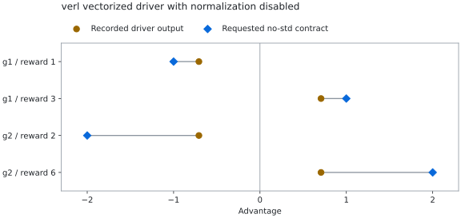

# A no-std request lost at the verl driver boundary

At verl revision `31cfccb4dbad8f1f4aa41a34eb589afbe283e8fe`, the vectorized
GRPO driver omits `norm_adv_by_std_in_grpo` when dispatching to its helper. A
caller requesting centered rewards without standard-deviation normalization
therefore receives normalized advantages. The values remain finite and have
plausible signs; the explicitly requested profile exposes the parameter mismatch.

This case captures that original driver result, reproduces it through the native
entry point, and exports a regression that fails before a small local fix and
passes after it. Status: locally reproduced and candidate-verified; upstream
review and acceptance remain unverified.

## The declared contract and observation

The example uses CPU float32 outcome rewards, two complete groups, stable sample
IDs, and explicit membership recorded after `DataProto.repeat()` and before
`DataProto.reorder()`. It requests `grpo_vectorized` with
`norm_adv_by_std_in_grpo=False`.

| Group | Rewards | Expected centered advantages | Pinned driver result, approximately |
|---|---|---|---|
| a | 1, 3 | −1, +1 | −0.7071063, +0.7071063 |
| b | 2, 6 | −2, +2 | −0.7071065, +0.7071065 |

<picture>
  <source media="(prefers-color-scheme: dark)" srcset="../assets/verl-normalization-dark.svg">
  <source media="(prefers-color-scheme: light)" srcset="../assets/verl-normalization.svg">
  
</picture>

The figure uses the public `verl-3` fixture in
[public-cases.json](../../tests/fixtures/public-cases.json). Its g1/g2 display
labels correspond to groups a/b above. Expected values are reward minus group
mean; recorded values come from each sample's first valid advantage token.

The token view multiplies these values by each response mask. The independent
Oracle reports `SUSPECTED_MISMATCH`, with maximum absolute error approximately
1.2928935. This verdict describes a discrepancy under the requested profile;
the driver/helper comparison and parameter-flow inspection establish its cause.

## Reproduce the capture

Use an environment with RLReplay and the pinned verl source plus compatible
dependencies installed. The example checks the qualified driver, algorithm and
groupwise owner fingerprints. Install the framework dependencies separately from
the lightweight Core. This fixture runs locally on preconstructed CPU tensors.

From the RLReplay repository root, use new output directories:

```bash
python examples/verl_observer.py demo-verl-healthy
python examples/verl_observer.py demo-verl-no-std --case known-no-std
```

The healthy scalar/std call returns exit 0 with one COMPLETE capsule and `PASS`.
The known vectorized/no-std call returns **exit 2 intentionally** and saves one
COMPLETE capsule with `SUSPECTED_MISMATCH`. Both perform semantic checking and
same-source native replay; the latter reproduces the captured values exactly.
`result.json` records the capsule path, requested profile, findings and coverage.
`receipts.json` preserves the worker's completion/check status.

Discover the single JSON capsule and run the ordinary CLI:

```bash
CAPSULE="$(python -c 'from pathlib import Path; paths = list(Path("demo-verl-no-std/capsules").glob("*.json")); assert len(paths) == 1, paths; print(paths[0])')"
python -m rlreplay check "$CAPSULE"
python -m rlreplay replay "$CAPSULE" --runner verl
python -m rlreplay export-test "$CAPSULE" regression-no-std
python -m pytest -q regression-no-std
```

The first two commands return exit 2. The export succeeds; the generated pytest
then fails against the original driver because it asserts that the replayed
candidate satisfies the declared contract. Preserve this failure as evidence.

## Explain and verify the local fix

The [scalar GRPO branch](https://github.com/verl-project/verl/blob/31cfccb4dbad8f1f4aa41a34eb589afbe283e8fe/verl/trainer/ppo/ray_trainer.py#L230-L243)
forwards the flag. The [generic estimator dispatch](https://github.com/verl-project/verl/blob/31cfccb4dbad8f1f4aa41a34eb589afbe283e8fe/verl/trainer/ppo/ray_trainer.py#L248-L282)
does not include it, and the
[vectorized helper](https://github.com/verl-project/verl/blob/31cfccb4dbad8f1f4aa41a34eb589afbe283e8fe/verl/trainer/ppo/core_algos.py#L335-L358)
defaults to normalization. Direct helper and scalar no-std controls honor the
request in the local verification.

In a separate reviewed candidate copy of that exact verl revision, immediately
after the generic `adv_kwargs` dictionary is built, add only:

```python
if adv_estimator == AdvantageEstimator.GRPO_VECTORIZED:
    adv_kwargs["norm_adv_by_std_in_grpo"] = norm_adv_by_std_in_grpo
```

Use a separate environment containing that candidate and rerun the **same
exported regression against the original capsule**:

```bash
python -m pytest -q regression-no-std
```

The local candidate passes. The exported test explicitly enables revision
changes for candidate verification; ordinary native replay requires matching
recorded owner/runtime fingerprints unless its revision-change option is
explicitly selected. Candidate verification retains the original capsule unchanged.
The capture example itself continues to require pristine qualified owners.

For source identification, the original `ray_trainer.py` SHA256 is
`eb41f99ccc66976eab14ebe35aa1aa5b7318e02469240ef1569ac4c884c94312`.
The locally verified candidate's driver SHA256 is
`f4ada6e45e80351fe28c4c2a512eb12624b35a36f36d4fe025dcd10c649a4a17`.
These identify the original and locally reviewed candidate source files.

This case qualifies function-level CPU replay and regression for a fixed
outcome-GRPO configuration. Full training correctness, model quality, production
overhead and other framework revisions require their own validation. TRL shares
the Evidence/Oracle/semantic-replay path; native replay and regression export
currently target verl.
